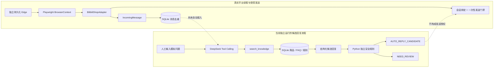

# ShopPilot

ShopPilot 是一个本地优先的 Python 电商客服智能回复原型，用于真实店铺实验、计算机本科生学习和技术面试展示。当前平台适配目标是 **B站小店（哔哩哔哩商家后台）**；Python 包名暂时保留为 `shoppilotbot`，以兼容已经验收的运行命令。

项目当前处于**受控原型和测试阶段**，不是大规模商用系统。它坚持两个原则：平台 DOM 必须经过真实页面验证后才能使用；任何发送能力都必须具备会话绑定、去重和人工授权。当前 Agent 只处理人工输入的模拟问题并输出候选结果，不会调用浏览器发送消息。

## 项目状态

“已编写”“自动化测试通过”和“真实平台验证”是三个不同状态：

| 功能 | 已编写 | 自动化测试 | 真实验收 |
| --- | --- | --- | --- |
| Playwright 启动独立持久化 Edge | 是 | 配置检查 | 是 |
| 手动登录并复用本地用户目录 | 是 | 不适合单元测试 | 是 |
| 从 `context.pages` 识别客服标签页 | 是 | 是 | 客服页地址已验证 |
| 客服入口生命周期与网络诊断 | 是 | 脱敏函数已测试 | 是 |
| 当前会话 DOM 探测 | 是 | 是 | 是 |
| 买家/商家消息区分 | 是 | 部分 | 买家消息读取成功，方向 DOM 已确认 |
| SQLite 消息去重 | 是 | 是，含跨重启测试 | 持续轮询和跨重启均通过 |
| 单条测试消息安全发送 | 是 | 是 | 是，买家端已收到 |
| 批量/自动回复 | 否 | 不适用 | 未开放 |
| DeepSeek Agent / Tool Calling | 是 | 是（假模型覆盖完整流程） | 真实 API 已用模拟问题验证 |
| SQLite 商品知识库 | 是 | 是 | 使用模拟数据完成本地验证 |
| Tkinter 人工审核 | 否 | 否 | 未验证 |

截至 2026-10-15，发布前离线测试实际结果为 `37 passed`。真实平台已完成跨重启去重、买家/商家方向识别，以及一条固定测试回复的发送闭环。知识库和 Agent 已通过自动化测试，并使用模拟问题完成真实 DeepSeek API 验收；该验收没有使用真实买家数据。

## 技术栈

- Python 3.11+
- Playwright + Microsoft Edge
- SQLite（Python 标准库）
- Pytest
- DeepSeek Chat Completions API（Python 标准库 HTTP 客户端）
- 计划接入：Tkinter

运行依赖只有 Playwright 和 python-dotenv；测试依赖为 Pytest。仓库不包含第三方电商机器人业务代码，也不复制平台未公开接口。

当前源码**没有使用 LangGraph**：Agent 是一个受限的两轮 Tool Calling 流程，直接由 Python 编排。这样更符合当前单机 MVP 的复杂度，也避免为了技术标签引入没有实际用途的框架。

## 当前架构



浏览器消息流与 Agent 候选回复流目前保持隔离。这是刻意的安全边界：`AUTO_REPLY_CANDIDATE` 只表示通过证据和规则检查，不能直接触发真实发送。

## 主要模块

| 模块 | 职责 |
| --- | --- |
| `browser.py` | Edge 启动、消息模型、消息/发送状态 SQLite、脱敏 DOM |
| `bilibili.py` | 当前会话识别、买家/商家方向判断、会话绑定发送 |
| `chat_probe.py` / `diagnostics.py` | 客服页识别、popup/frame/Console/Network 脱敏诊断 |
| `knowledge.py` | 商品、FAQ、售后规则导入与参数化 SQL 检索 |
| `agent.py` | DeepSeek Tool Calling、结构化结果、Token 统计和独立决策 |
| `agent_cli.py` | 仅针对人工输入模拟问题的本地 Agent 演示入口 |
| `stage2.py` | 固定测试回复、DRY_RUN 预览和一次性人工授权 |

## 安装

在 Windows PowerShell 中：

```powershell
python -m venv .venv
.\.venv\Scripts\python.exe -m pip install -e ".[dev]"
Copy-Item .env.example .env
New-Item -ItemType Directory -Force .runtime | Out-Null
Copy-Item config/selectors.example.json .runtime/bilibili_selectors.json
```

默认使用 `channel="msedge"` 和项目专属的 `edge_bilibili_profile/`。它不会读取或修改日常使用的 Edge 用户配置。

## 阶段一：只读客服消息

首次确认真实消息 DOM：

```powershell
.\.venv\Scripts\python.exe -m shoppilotbot.cli probe-chat
```

程序会：

1. 从 `context.pages` 查找此前诊断确认过的客服主文档。
2. 如果客服页没有恢复，等待店主手动从商家后台进入。
3. 明确提示店主使用自己的测试买家账号发送“你好”。
4. 只保存该测试文本周围的脱敏结构和不含正文的 DOM 骨架。
5. 等待人工确认定位器，然后在同一进程内转入当前会话只读监听。

仓库中的示例定位器来自 2026-10-14 的真实页面验证。复制到 `.runtime/` 后可直接运行：

```powershell
.\.venv\Scripts\python.exe -m shoppilotbot.cli listen
```

程序启动时会把当前可见消息记为基线。基线建立后发送的新消息才会作为新消息输出。监听持续到店主按 `Ctrl+C`。

通用脱敏 DOM 检查和客服入口诊断命令分别为：

```powershell
.\.venv\Scripts\python.exe -m shoppilotbot.cli inspect
.\.venv\Scripts\python.exe -m shoppilotbot.cli diagnose-entry
```

这些命令不会自动点击客服入口、刷新页面或发送消息。

## 阶段二：安全测试发送

先以只读方式验证跨重启去重和消息方向：

```powershell
.\.venv\Scripts\python.exe -m shoppilotbot.stage2 verify
```

再启动专用测试发送流程：

```powershell
.\.venv\Scripts\python.exe -m shoppilotbot.stage2 send-test
```

`send-test` 只允许固定回复 `ShopPilotBot 测试回复，请忽略。`。程序先执行 `DRY_RUN` 预览，然后生成包含脱敏会话标识和随机码的一次性授权短语。只有店主原样确认后，才会对当前 `data-mid` 完全一致的会话填写正文并单击一次。

发送尝试会先写入 SQLite，但只保存会话哈希、正文哈希和状态，不保存原始会话 ID 或正文。页面出现新增的同文本商家消息时记录 `SENT`；点击后无法确认时记录 `UNKNOWN`，两种状态均禁止自动重试。相同会话和正文的重复请求也会在点击前被阻止。

## 阶段三：SQLite 知识库与 DeepSeek Agent

先导入仓库中明确标记的模拟商品资料：

```powershell
.\.venv\Scripts\python.exe -m shoppilotbot.agent_cli import
.\.venv\Scripts\python.exe -m shoppilotbot.agent_cli search "星云随行杯 材质"
```

运行数据库默认是 `.runtime/knowledge.db`，不会提交到 Git。导入器只接受固定 JSON 结构；检索函数只查询代码定义的表和列，所有搜索词都使用 SQL 参数绑定，模型不能生成或执行任意 SQL。

要测试真实 DeepSeek Tool Calling，只在本机 `.env` 中填写 `DEEPSEEK_API_KEY`，不要把密钥粘贴到聊天、日志或 GitHub，然后运行：

```powershell
.\.venv\Scripts\python.exe -m shoppilotbot.agent_cli ask
```

CLI 只接受店主人工输入的模拟问题。Agent 最多执行一次 `search_knowledge` 工具调用和两次有超时、Token 上限的模型请求。返回结果包含候选回复、`AUTO_REPLY_CANDIDATE` 或 `NEED_REVIEW`、知识证据 ID、审核原因和工具轨迹；它不导入浏览器模块，也没有消息发送入口。

Python 规则会独立拦截退款、投诉、赔偿、订单变更等高风险问题，以及空证据、越权证据、未批准知识、未授权承诺和证据中不存在的数字。模型超时、网络错误、无工具调用或格式错误一律安全降级为 `NEED_REVIEW`。模型给出的置信度不会参与放行。

示例资料全部标记为 `is_simulated=true`，只用于本地演示。真实商品资料必须由店主核对来源和更新时间后再导入；本阶段即使得到 `AUTO_REPLY_CANDIDATE` 也不会向真实买家发送。

2026-10-14 的真实 API 验收结果：

- 已知材质问题：模型调用 `search_knowledge("星云随行杯 材质")`，SQLite 返回商品与 FAQ 证据，结果为 `AUTO_REPLY_CANDIDATE`。
- 同义问题：模型将“杯身是什么做的”转换为材质查询，SQLite 返回 FAQ 证据，结果为 `AUTO_REPLY_CANDIDATE`。
- 未知无线充电问题：首次测试暴露“商品名命中但问题事实缺失”仍被放行的缺口；增加知识不足门禁和回归测试后，真实复测为 `NEED_REVIEW`。
- 退款赔偿问题：Python 在 API 请求前直接返回 `NEED_REVIEW`，Token 用量为 0。
- 包含缺口发现和修复复测在内，共执行 8 次 API 请求，API 返回累计 4,431 tokens（输入 3,783、输出 648，其中输入缓存命中 512、未命中 3,271）。

按验收时 DeepSeek [模型与价格](https://api-docs.deepseek.com/zh-cn/quick_start/pricing/) 页面公布的 `deepseek-flash` 空闲时段人民币单价估算，本次费用约为 ¥0.0059；实际扣费以 DeepSeek 账户账单为准，价格可能调整。

## 去重设计与限制

`ProcessedMessageStore` 只持久化消息哈希、脱敏会话键和首次观察时间，不保存买家名称或聊天正文。

- 首选：`conversation_key + 平台消息 ID`。
- 回退：`conversation_key + 正文 + 平台时间 + 消息方向 + 同类消息出现序号`，再计算 SHA-256。

当前真实 DOM 未发现稳定的平台消息 ID，因此使用回退方案。它不是仅按正文去重，但如果虚拟滚动改变历史消息的可见顺序、平台时间缺失或格式变化，仍可能出现误判。

## 测试

```powershell
.\.venv\Scripts\python.exe -m pytest -q
```

当前自动化测试覆盖：

- 文本规范化和消息指纹。
- 不同会话隔离。
- SQLite 重启后的持久化去重。
- 已验证客服 URL 的识别。
- 日志 URL/Token 脱敏。
- 一次性发送授权与会话绑定。
- SQLite 发送状态和重复发送保护。
- 含中文授权短语的安全比较。
- 知识 JSON 校验、参数化 SQLite 检索和模拟资料标识。
- DeepSeek Tool Calling 的本地假模型流程。
- 已知/同义商品问题、未知知识和高风险问题决策。
- API 超时、未调用工具、无效 JSON、越权证据、虚构承诺和无依据数字的安全降级。
- 多轮 API Token 用量汇总，以及“证据存在但未回答问题”的知识不足门禁。

## 已知问题与限制

- 曾观察到客服入口打开的新标签页停留在 `about:blank`。加入事件监听后再次测试时，popup、主 frame 导航和客服页面均正常加载，原问题未复现，根因尚未确定，不能视为已修复。
- 2026-10-14 已真实验证当前会话列表、正文、平台时间和消息方向定位器，但尚未发现稳定平台消息 ID；CSS Modules 类名可能随平台发布变化。
- 同一运行进程和真实浏览器重启后的消息去重均已验证。
- 当前只读取店主已经打开的会话，不主动遍历或切换所有买家。
- 平台页面更新可能导致定位器失效；页面状态无法确认时必须停止处理。
- `UNKNOWN` 分支已有代码保护，但尚未在真实平台故意制造发送结果不确定场景。
- DeepSeek Tool Calling 已通过模拟问题的真实 API 验收，但尚未获准接收真实买家消息。
- 当前模拟知识可生成候选回复，但不能代表真实店铺商品资料；真实知识仍需店主确认。
- 尚未实现人工审核和自动回复；真实发送目前只开放专用命令中的一次性固定测试回复。

详见 [开发日志](docs/development-log.md)。

用于双选会讲解的项目介绍、架构、真实 Bug 案例、演示步骤和常见追问见 [面试准备](docs/interview-preparation.md)。

## 安全设计

- 全局默认并保持 `SHOPPILOT_DRY_RUN=true`；关闭该变量也不能开启批量发送。
- 真实发送只能由专用 `send-test` 命令的一次性、会话绑定授权放行。
- 不绕过验证码、风控或访问控制，不调用未经授权的内部接口。
- Cookie、Token、登录状态和买家信息不发送到外部模型或调试服务。
- 浏览器配置、`.env`、SQLite、日志、DOM 探测结果和截图均由 `.gitignore` 排除。
- DOM 探测不保存聊天正文、表单值、Cookie、URL 参数或动态属性值。
- 登录失效、会话不唯一或页面结构变化时停止处理并提示人工。
- Agent 与浏览器发送链路完全分离；候选状态本身不构成发送授权。
- 高风险问题在调用模型前即转人工；模型失败不会降级为无依据回复。

推送前执行：

```powershell
git status --short
git diff --cached --name-only
git diff --cached
git ls-files -- ".env" "*.db" "*.sqlite3" "*.log" "*.jsonl" `
  "edge_bilibili_profile/**" "edge_bot_profile/**" `
  "browser_profile/**" ".browser_profile/**" ".runtime/**"
```

最后一条命令应无输出。

## 个人开发与第三方依赖

本仓库中的业务流程、B站页面适配、诊断、脱敏和去重代码均为本项目自行编写。早期曾尝试接入拼多多网页，随后按实际需求切换到 B站小店；拼多多平台配置和定位代码未保留在当前基线中。

项目只使用通用开源依赖：Playwright、python-dotenv 和 Pytest。依赖代码不复制进仓库，具体版本范围见 `pyproject.toml`。
